# Anleitung: PermLens in 15 Minuten

*English version: [MANUAL.md](MANUAL.md)*

PermLens ist ein Rechte-Manager für LXC-Container, derzeit speziell für Proxmox VE. Er zeigt, welche Benutzer es in deinen Containern gibt, wer sie auf dem Proxmox sind und wer auf welche eingehängten Ordner zugreifen darf. Auf Wunsch setzt er die Lösung auch selbst um, immer mit Vorschau und Rückgängig.

Diese Anleitung führt einmal durch alles. Die Einzelheiten stehen in eigenen Anleitungen:

| Thema | Anleitung |
|---|---|
| Installieren, Schritt für Schritt | [INSTALLATION.md](INSTALLATION.md) |
| Update, Sichern, Entfernen | [BETRIEB.md](BETRIEB.md) |
| Was PermLens auf dem Proxmox darf | [SICHERHEIT.md](SICHERHEIT.md) |
| Prüfen und Probleme, wie PermLens rechnet | [DIAGNOSE.md](DIAGNOSE.md) |
| Benutzer, Gruppen und Rechte ändern | [AENDERN.md](AENDERN.md) |
| Mapping, unprivilegiert machen | [MAPPING.md](MAPPING.md) |

## 1. Einrichten

1. **Einen LXC für PermLens anlegen** (Debian 13, unprivilegiert, feste IP-Adresse) und Docker darin installieren.
2. **PermLens starten**, am bequemsten als Stack in Dockhand mit [`docker-compose.homelab.yml`](../docker-compose.homelab.yml). Das Passwort kommt als Variable `APP_PASSWORD` dazu.
3. **Im Browser öffnen:** `https://<IP-des-LXC>:8443`. Beim ersten Besuch warnt der Browser, weil PermLens ein eigenes Zertifikat hat. Wie du prüfst, dass es deines ist, steht in [INSTALLATION.md](INSTALLATION.md#4-im-browser-öffnen).
4. **Mit dem Proxmox verbinden:** PermLens zeigt einen einzigen Befehl. Den in die Shell des Proxmox kopieren (Weboberfläche → Knoten → „>_ Shell“) und Enter drücken. Vorher bitte [SICHERHEIT.md](SICHERHEIT.md) lesen: Dort steht genau, was der Befehl tut.

Danach liest PermLens alle Container ein und springt von selbst zur Übersicht. Alle Schritte im Detail: [INSTALLATION.md](INSTALLATION.md).

<picture><source media="(prefers-color-scheme: dark)" srcset="bilder/anmeldung-dunkel.png">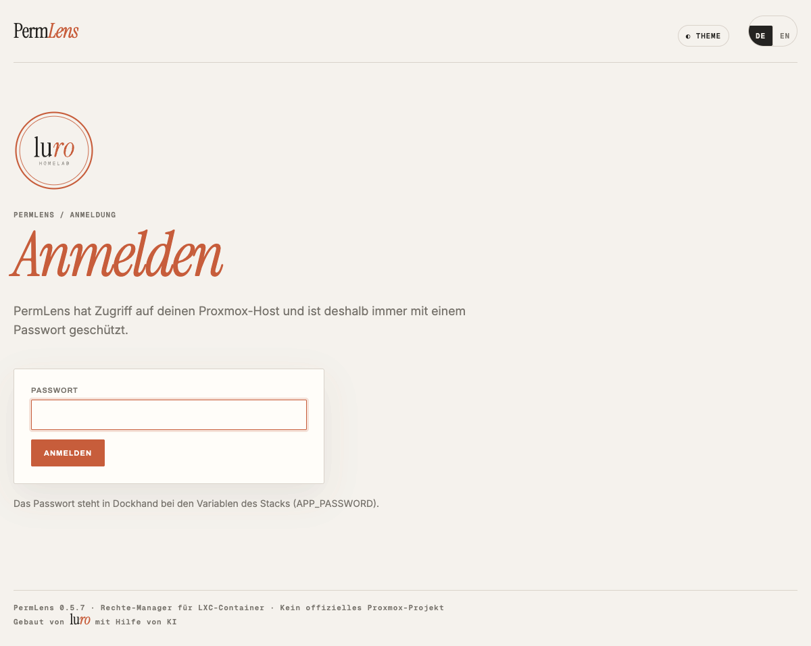</picture>

**Empfohlen:** gleich danach unter *Einstellungen → Zwei-Faktor-Anmeldung* einen Code aus einer Authenticator-App dazuschalten.

## 2. Die Oberfläche

<picture><source media="(prefers-color-scheme: dark)" srcset="bilder/uebersicht-dunkel.png">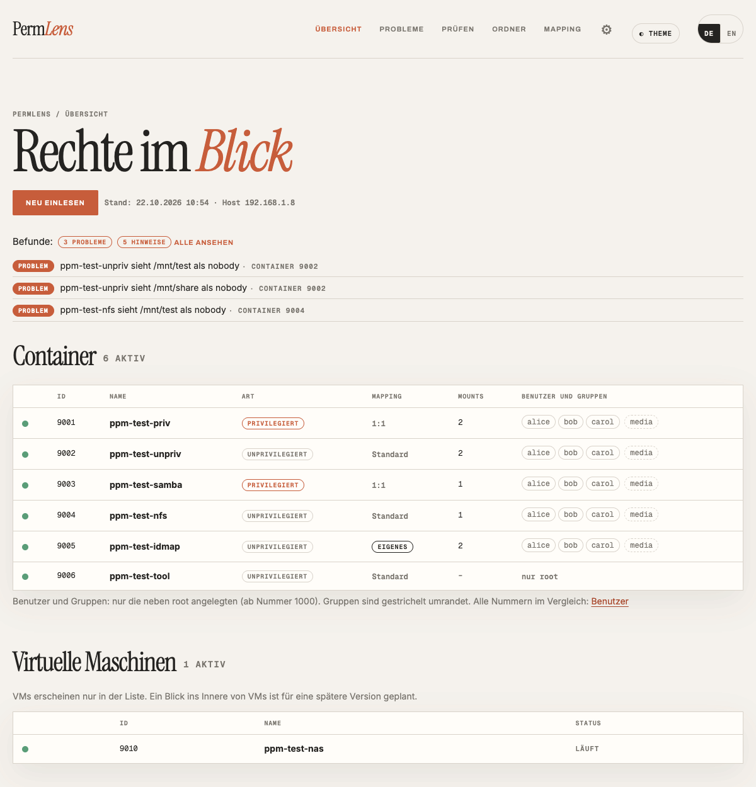</picture>

Oben stehen fünf Menüpunkte:

| Menü | Beantwortet |
|---|---|
| **Übersicht** | Wie steht es? Die drei wichtigsten Probleme, darunter alle Container und VMs. Hier ist auch der Knopf **„Neu einlesen“**. |
| **Probleme** | Ist alles in Ordnung? Alles, was PermLens von selbst gefunden hat, mit Empfehlung. |
| **Prüfen** | Kann wer hier schreiben? |
| **Ordner** | Wem gehört welcher Ordner, und wie sieht ihn jeder Container? |
| **Mapping** | Wie bekommt ein unprivilegierter Container Zugriff auf Ordner des Proxmox? |

Unter dem **Zahnrad** liegen *Einstellungen*, *Änderungen* (das Protokoll mit Rückgängig), *Nachschauen* (die Konsole, Abschnitt 4) und *Abmelden*. Rechts daneben wechselst du zwischen hell und dunkel und zwischen Deutsch und Englisch.

**PermLens liest nicht ständig nach.** Es zeigt den Stand vom letzten Einlesen (Zeit steht auf jeder Seite). Hast du auf dem Proxmox etwas geändert, auf der Übersicht „Neu einlesen“ klicken. Das dauert meist 10 bis 30 Sekunden.

**Mehrere Proxmox:** Unter *Einstellungen → Proxmox → Weiteren Proxmox hinzufügen …* kommt ein weiterer dazu. Welchen du gerade ansiehst, wählst du dann unter der Kopfzeile. Jeder hat seinen eigenen Stand.

### Die Container-Seite

Ein Klick auf einen Container in der Übersicht öffnet seine Seite mit diesen Reitern:

| Reiter | Inhalt |
|---|---|
| **Überblick** | Art (privilegiert oder unprivilegiert), Mapping, Probleme dieses Containers, Knopf zum Mapping-Assistenten |
| **Benutzer und Gruppen** | Jeder Benutzer als Karte: wofür er da ist, welche Nummer er auf dem Proxmox hat und was er in den eingehängten Ordnern darf. Dazu „Nummern ohne Namen“, z. B. von Docker-Apps. |
| **Ordner** | Eingehängte Ordner und Freigaben (Samba, NFS), je Ordner „Prüfen“ und „Rechte ändern …“ |
| **Docker** | Nur wenn im Container Docker läuft (ab 1.1.0): je App, als wer sie schreibt, wer das im Container und auf dem Proxmox ist und was sie in ihren Ordnern darf. Mehr unten bei „Und Docker-Apps?“ |
| **Host-Einstellungen** | Die Zeilen aus `/etc/pve/lxc/<Nr>.conf`, die wichtigen hervorgehoben und erklärt. Nur zum Ansehen. |

Rechts daneben öffnet **„Nachschauen →“** die Konsole für diesen Container.

Gestoppte Container zeigen nur ihre Einstellungen. Benutzer und die Sicht von innen gibt es erst, wenn der Container läuft.

<picture><source media="(prefers-color-scheme: dark)" srcset="bilder/container-host-dunkel.png">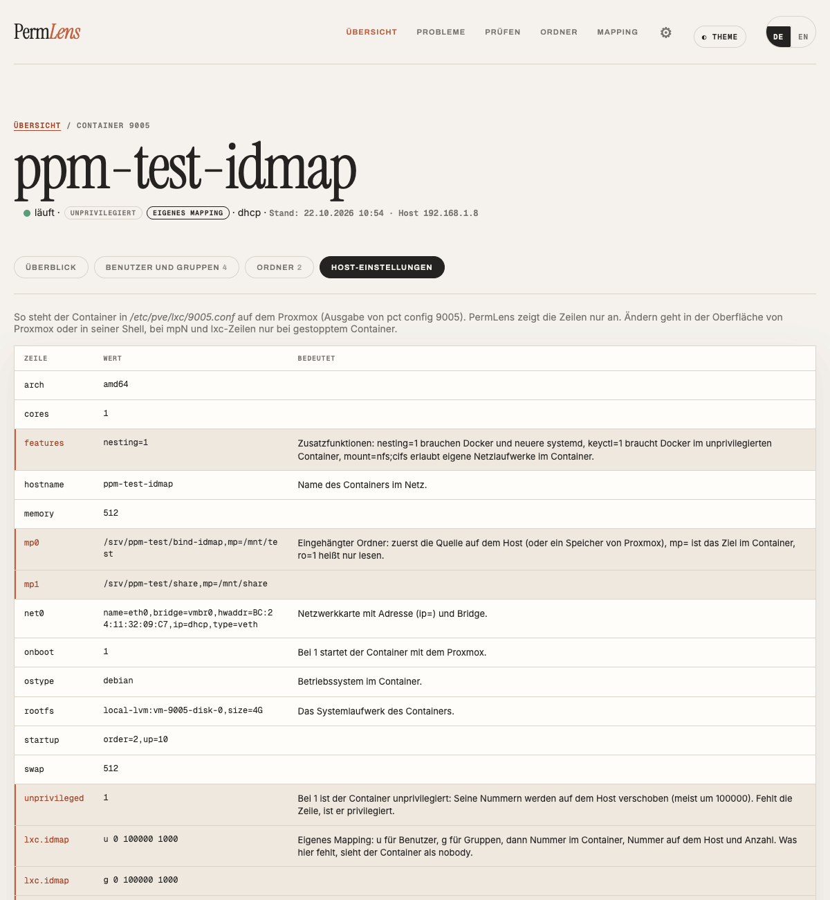</picture>

## 3. Die vier Aufgaben

### Ist alles in Ordnung?

1. **Übersicht** öffnen. Oben stehen die drei wichtigsten Probleme, daneben die Zahl aller Befunde.
2. **Probleme** zeigt alle. Jeder Befund hat eine Stufe: *Problem* (etwas geht nicht), *Hinweis* (geht, ist aber riskant oder wackelig), *Info* (gut zu wissen).
3. Ein Befund aufklappen: Was steckt dahinter, was kannst du tun? Viele haben einen Befehl zum Kopieren, einen Knopf „Mit PermLens ausführen …“ oder einen Link zum passenden Werkzeug.

<picture><source media="(prefers-color-scheme: dark)" srcset="bilder/probleme-dunkel.png">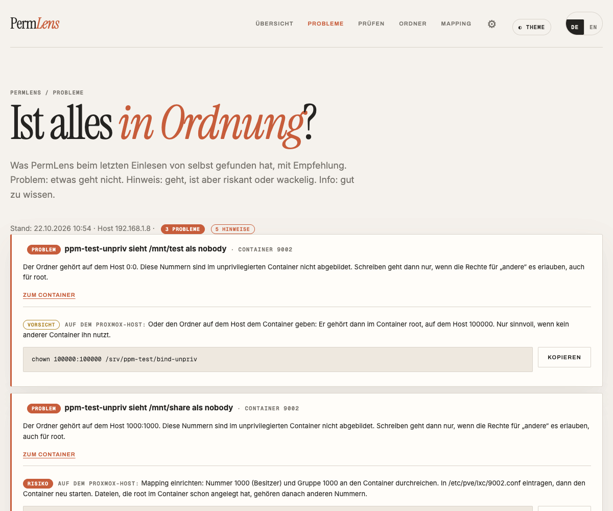</picture>

Alle Befunde und was sie bedeuten: [DIAGNOSE.md, Abschnitt „Befunde“](DIAGNOSE.md#die-seite-probleme-befunde).

### Kann X hier schreiben?

1. **Prüfen** öffnen (oder auf der Container-Seite im Reiter Ordner auf „Prüfen“ klicken).
2. Container, Benutzer und Ordner wählen, „Prüfen“ klicken.
3. Oben steht die Antwort: **Lesen ja/nein, Schreiben ja/nein** und die Ursache in einem Satz, z. B. „Der Ordner gehört auf dem Proxmox einer Nummer, die dieser Container nicht kennt (nobody).“
4. Darunter **„So geht es“**: die Empfehlungen mit Befehl und Einstufung (harmlos, Vorsicht, Risiko).
5. Eingeklappt: **„Sicher gehen“** (das System selbst fragen oder ein echter Schreibtest) und **„So hat PermLens gerechnet“** (jeder Ordner auf dem Weg).

<picture><source media="(prefers-color-scheme: dark)" srcset="bilder/pruefen-dunkel.png">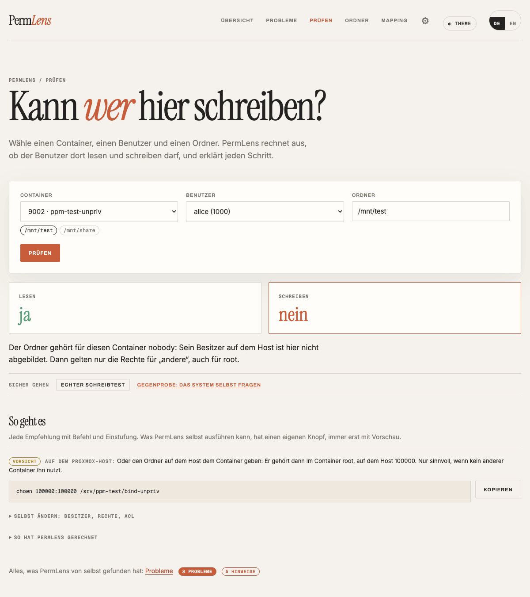</picture>

Wie PermLens rechnet und warum der Name nicht zählt, sondern die Nummer: [DIAGNOSE.md](DIAGNOSE.md).

#### Und Docker-Apps?

Viele Apps laufen in Docker in einem LXC. Sie haben dort dieselben Nummern wie der LXC selbst: Schreibt paperless als 1000, gehört die Datei im LXC der 1000 und auf dem Proxmox der Nummer, auf die der LXC die 1000 abbildet (meist 101000).

1. Container-Seite → **Docker**. Je App steht die Kette **schreibt als → im Container → auf dem Proxmox** und darunter jeder eingehängte Ordner mit Besitzer, Lesen und Schreiben.
2. *Schreibt als* misst PermLens an den laufenden Programmen der App. Viele Images starten als root und wechseln dann zu `PUID`; gezählt wird, als wer die eigentlichen Programme laufen. Läuft die App nicht, nimmt PermLens `PUID`/`USERMAP_UID` aus der Stack-Datei oder den Benutzer aus dem Image.
3. **„Prüfen“** neben einem Ordner rechnet wie bei einem Benutzer. Unter *Prüfen* stehen die Apps auch in der Auswahl der Benutzer. Die Empfehlung ist dann meist: der App mit `PUID`/`PGID` oder `user:` eine Nummer geben, die zum Ordner passt.
4. Auf der Seite *Probleme* meldet PermLens: eine App, die nicht in ihren Ordner schreiben kann, eine App, die als root schreibt, und eine App, bei der `PUID` gesetzt ist, die aber trotzdem als eine andere Nummer läuft.

<picture><source media="(prefers-color-scheme: dark)" srcset="bilder/container-docker-dunkel.png">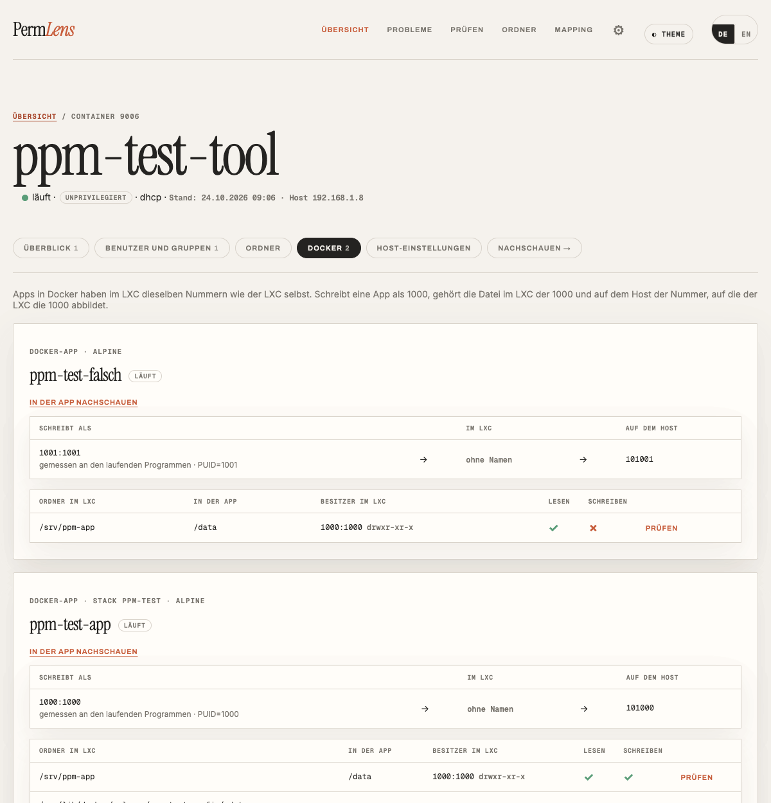</picture>

PermLens liest von jeder App nur Name, Image, Zustand, Benutzer, Ordner und die Nummern-Variablen wie `PUID`. Andere Umgebungsvariablen (dort stehen oft Passwörter) gibt der Wächter auf dem Proxmox nie heraus. Dafür braucht der Proxmox das Wächter-Script **Version 8** (*Einstellungen → Neu einrichten*).

### Benutzer und Gruppen ändern

Ändern ist **ausgeschaltet**, bis du es auf dem Proxmox für bestimmte Container einschaltest. Dafür in der Shell des Proxmox die Nummern der Container in eine Datei schreiben, z. B. für 105 und 110 bis 112:

```bash
mkdir -p /etc/permlens && echo '105,110-112' > /etc/permlens/schreiben-erlaubt
```

Dann in PermLens *Einstellungen → Verbindung testen*. Alle anderen Container bleiben nur lesbar.

1. Container-Seite → **Benutzer und Gruppen**.
2. Oben „Neuer Benutzer …“ oder „Neue Gruppe …“. In jeder Zeile „Ändern …“: in eine Gruppe aufnehmen, Hauptgruppe ändern, Nummer ändern, löschen.
3. Jede Aktion öffnet zuerst eine **Vorschau**: genauer Befehl, Einstufung, vorher und nachher, was sich für die Benutzer ändert, und der Befehl zum Rückgängigmachen. Noch passiert nichts.
4. **Ausführen.** Bei *Risiko* tippst du zur Sicherheit die Container-Nummer ein.
5. Unter *Zahnrad → Änderungen* steht jede Änderung, mit Knopf **„Rückgängig“** (wieder mit Vorschau).

<picture><source media="(prefers-color-scheme: dark)" srcset="bilder/container-benutzer-dunkel.png">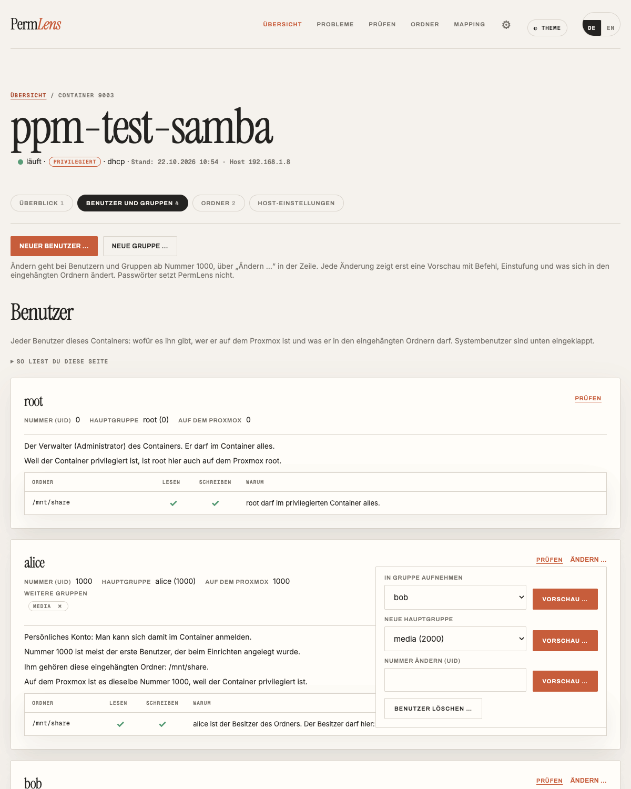</picture>

<picture><source media="(prefers-color-scheme: dark)" srcset="bilder/vorschau-dunkel.png">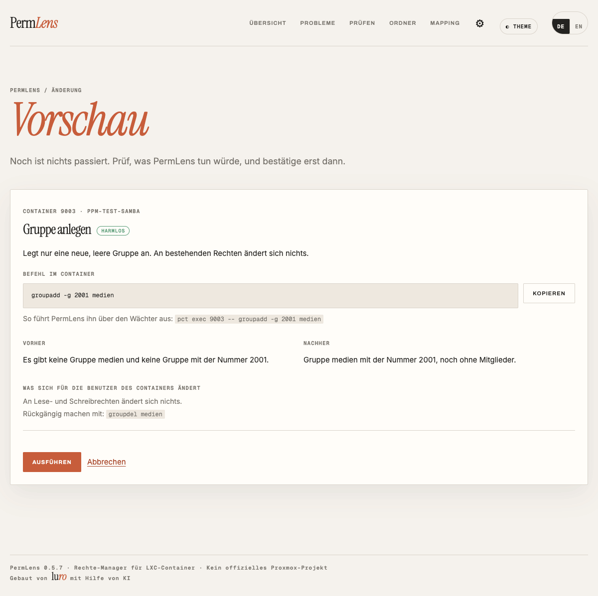</picture>

<picture><source media="(prefers-color-scheme: dark)" srcset="bilder/aenderungen-dunkel.png">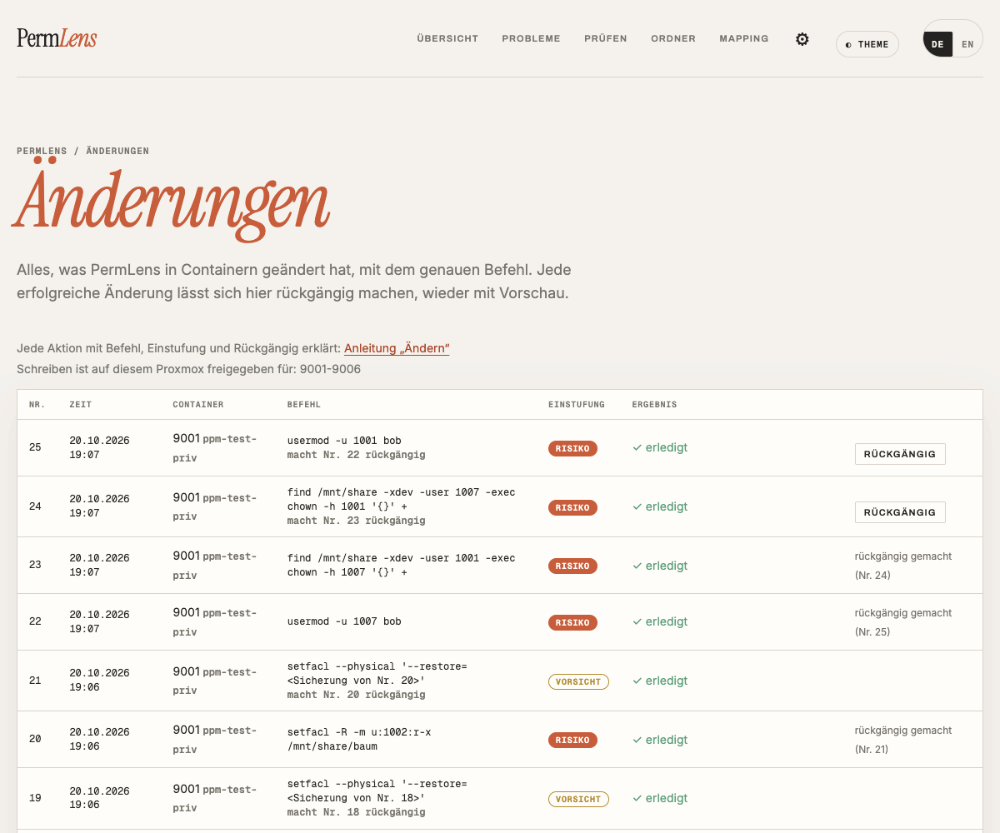</picture>

Rechte von Ordnern änderst du über *Prüfen → So geht es* oder im Reiter Ordner mit „Rechte ändern …“. Passwörter setzt PermLens nie, den Befehl dafür tippst du selbst im Container. Alles Weitere: [AENDERN.md](AENDERN.md).

### Container unprivilegiert machen

Ein privilegierter Container ist bequem (root im Container ist root auf dem Proxmox), aber schwächer abgeschottet. Umstellen geht nicht mit einem Häkchen, weil dann alle Dateien im Container den falschen Nummern gehören.

1. Container-Seite → Überblick → **„Unprivilegiert machen …“**. Das öffnet den Mapping-Assistenten, Reiter *Privilegiert → unprivilegiert*.
2. PermLens rechnet aus, welche Nummern in den eingehängten Ordnern vorkommen und durchgereicht werden müssen, und schreibt dir alle Befehle auf: sichern, als **neuer** Container unprivilegiert wiederherstellen, Mapping eintragen, Dateien zurückgeben, starten, prüfen.
3. Die Befehle führst du selbst in der Shell des Proxmox aus. Der alte Container bleibt unverändert als Rückfall. Erst nach einigen Tagen löschen.
4. Danach in PermLens „Neu einlesen“ und mit *Prüfen* nachsehen, ob alle wichtigen Benutzer wieder schreiben dürfen.

<picture><source media="(prefers-color-scheme: dark)" srcset="bilder/mapping-umstieg-dunkel.png">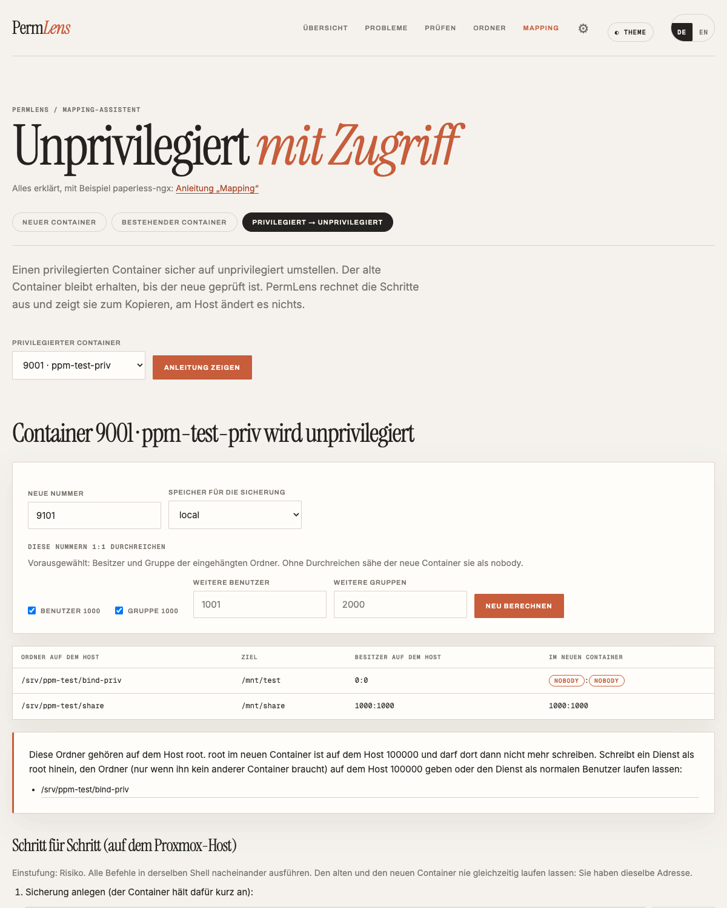</picture>

Für einen unprivilegierten Container, der Ordner als nobody sieht, gibt es im selben Assistenten den Reiter *Bestehender Container* (auf der Container-Seite: „Mapping planen …“), für einen neuen Container den *Bauplan*. Alles dazu: [MAPPING.md](MAPPING.md).

## 4. Schnell nachschauen

Für den kurzen Blick, ohne in die Proxmox-Shell oder nach Dockhand zu wechseln: *Zahnrad → Nachschauen* oder auf der Container-Seite **„Nachschauen →“**.

1. Oben wählen, wo: der Proxmox, ein laufender Container oder eine Docker-App darin.
2. Einen Befehl eintippen oder einen der Knöpfe darunter anklicken, z. B. `id alice`, `ls -ld /mnt/daten`, `stat /data` oder `docker ps`. `hilfe` zeigt alle.
3. Die Antwort erscheint darunter wie im Terminal, dazu der genaue Befehl, der an den Wächter ging.

Die Konsole kennt **nur feste, lesende Befehle**. Eine Shell gibt es nicht, auch keine Dateiinhalte. Den Inhalt eines Ordners (`ls -l`) zeigt sie nur in Containern, in denen Ändern freigegeben ist. Ins Protokoll kommt, wann welcher Befehl lief, nie die Ausgabe. Für Container und Docker-Apps braucht der Proxmox das Wächter-Script Version 8.

<picture><source media="(prefers-color-scheme: dark)" srcset="bilder/konsole-dunkel.png">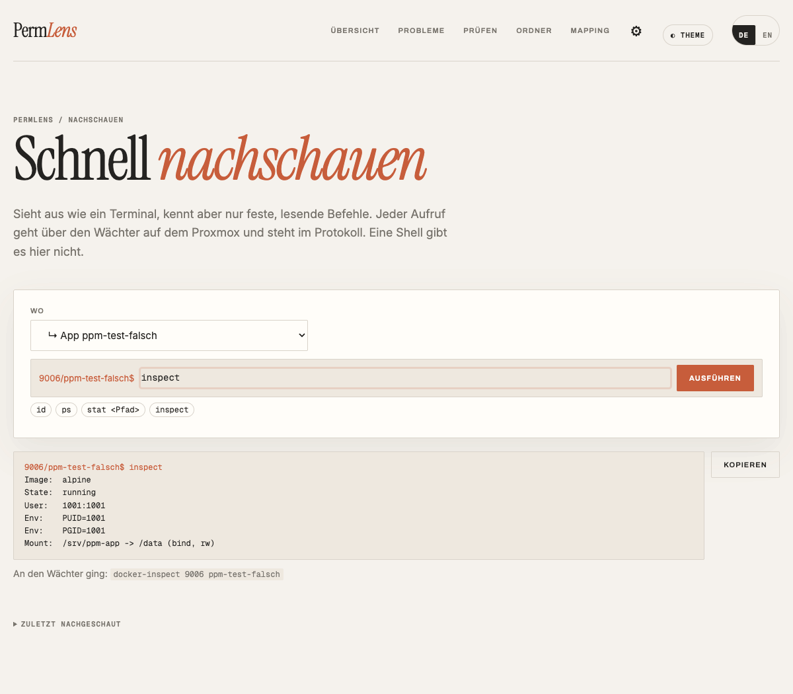</picture>

## 5. Einstellungen

| Abschnitt | Wofür |
|---|---|
| **Proxmox** | Die verbundenen Proxmox, mit Wächter-Version und den Containern, in denen Ändern erlaubt ist. Weiteren hinzufügen, umbenennen, entfernen. |
| **Verbindung** | Verbindung testen, Neu einrichten (z. B. für ein neues Wächter-Script), Befehle zum Ein- und Ausschalten des Änderns |
| **Zwei-Faktor-Anmeldung** | Code aus einer Authenticator-App zusätzlich zum Passwort |
| **Updates** | Hinweis, wenn es eine neue Version gibt. Eingespielt wird nichts von selbst. |

## 6. Was PermLens nicht macht

- **Nichts ohne Vorschau.** Jede Änderung zeigt vorher den genauen Befehl.
- **Nichts an Systemordnern** wie `/etc` oder `/usr`, nichts an root und Systemkonten, keine Passwörter.
- **Nichts am Proxmox selbst.** Mapping, Mount-Punkte und `/etc/subuid` zeigt PermLens als Befehle, ausführen machst du sie.
- **Nichts auf einem NAS.** Rechte-Listen einer Synology, UGREEN oder TrueNAS kann PermLens nicht lesen. Es sagt dir aber, wenn die Lösung dort liegt.
- **Kein Blick in VMs.** Sie erscheinen nur in der Liste.
