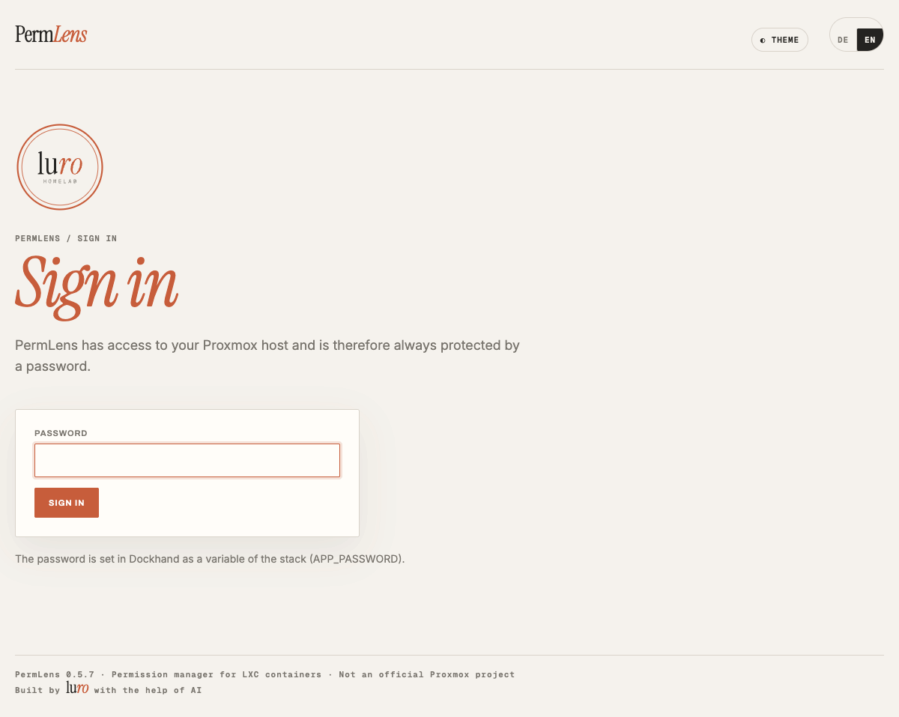
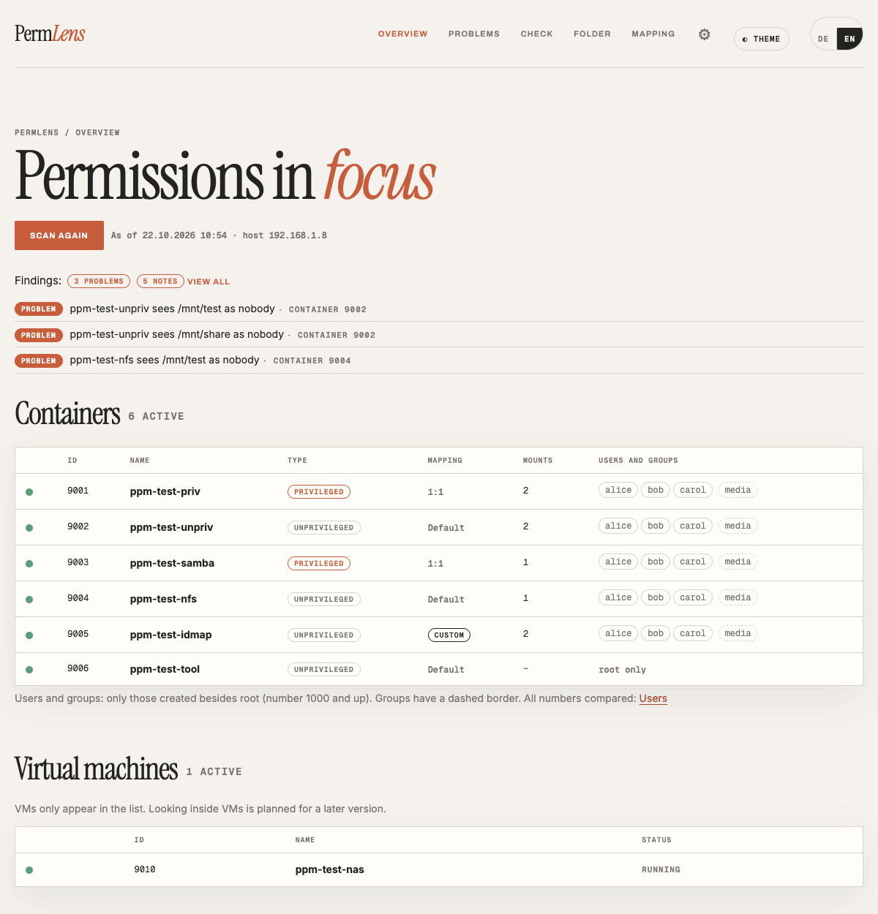
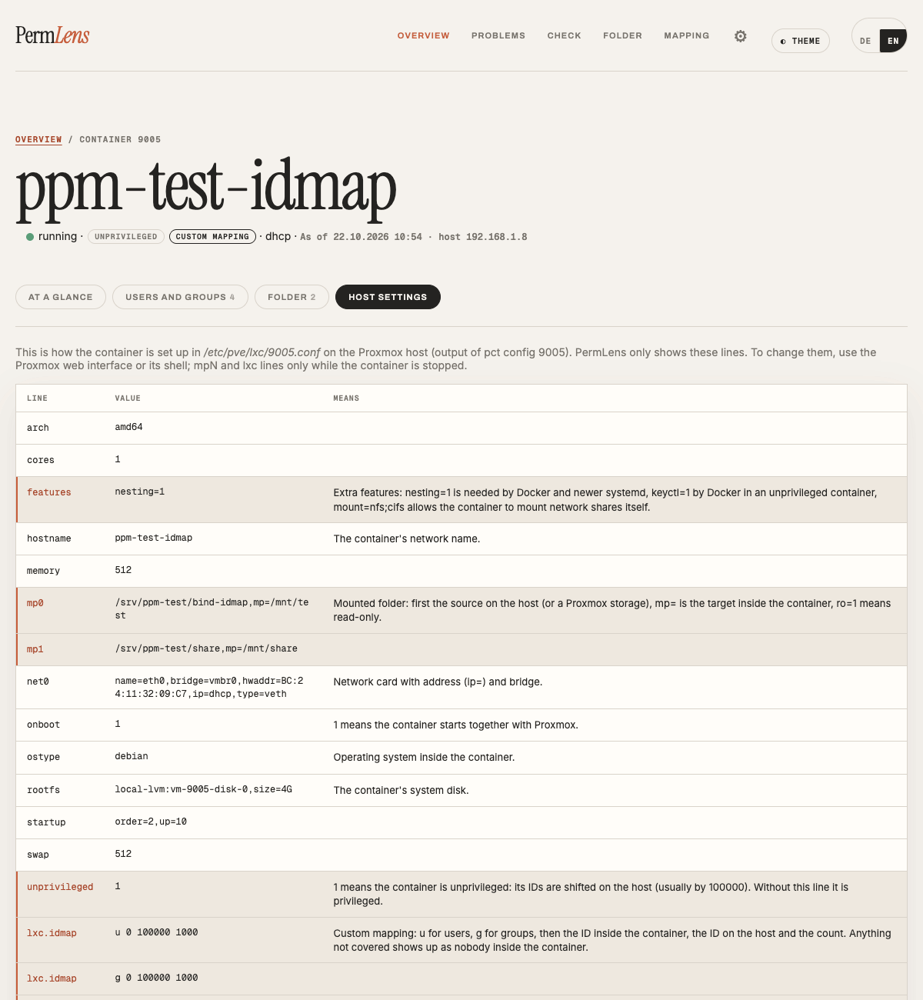
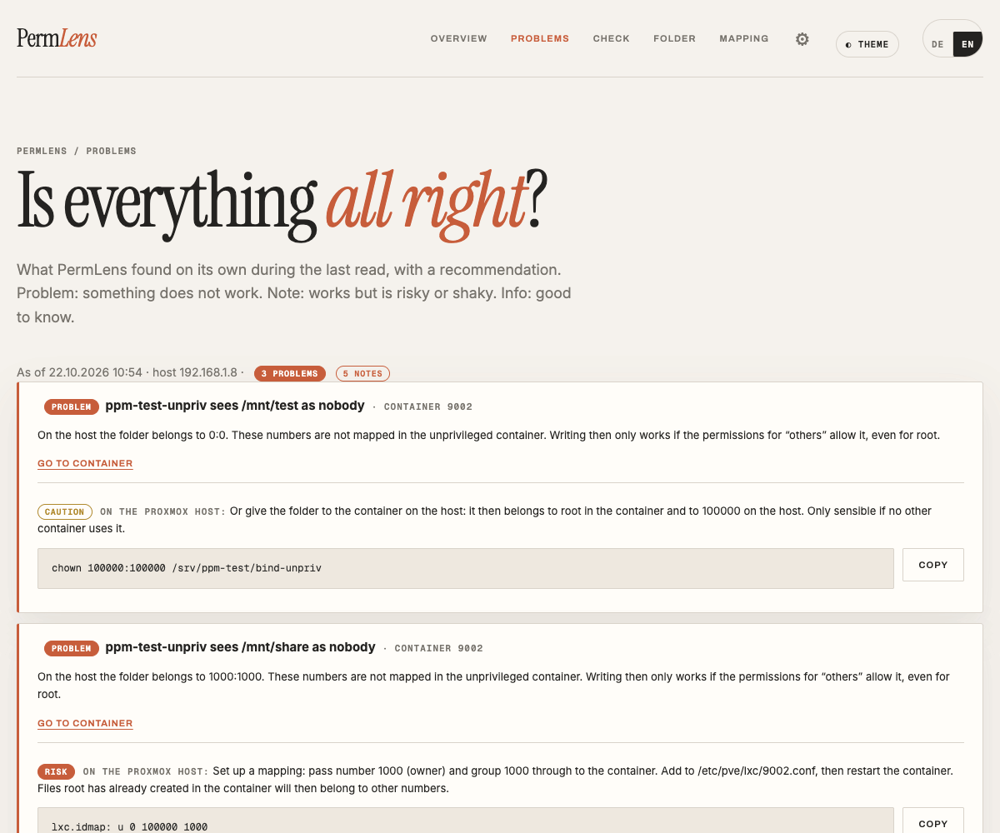
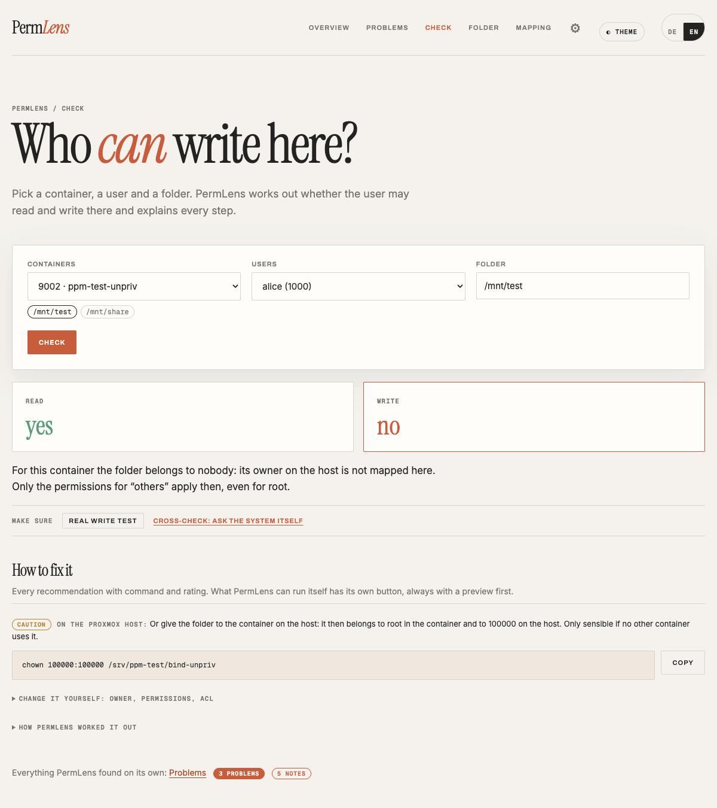
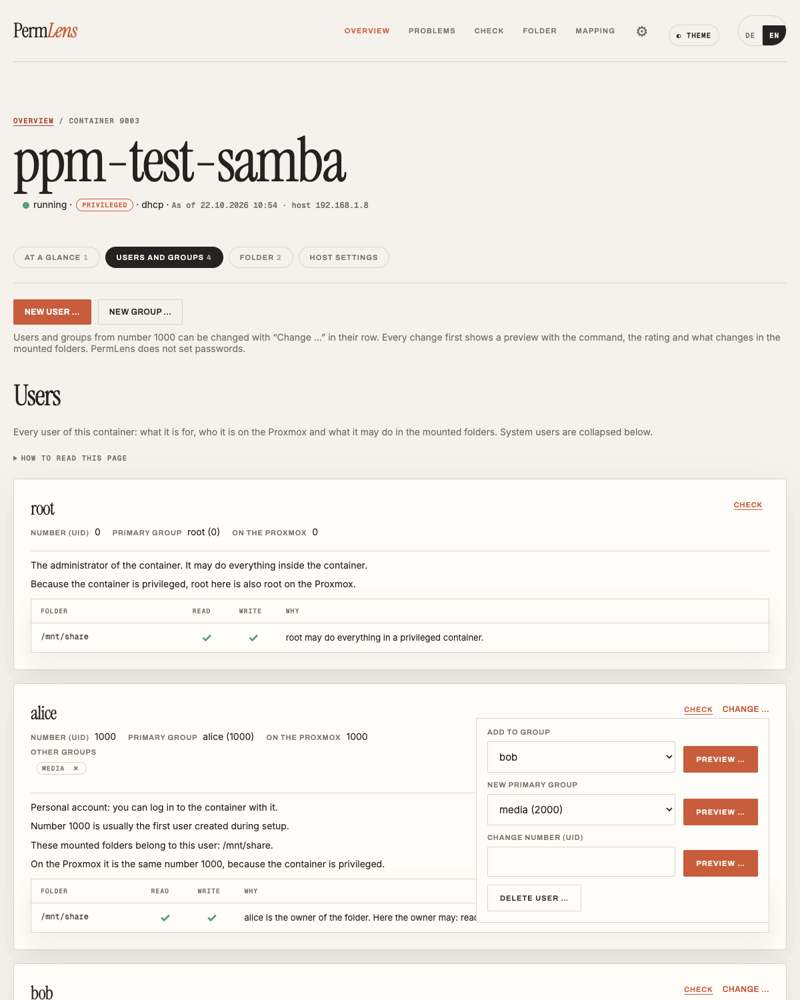
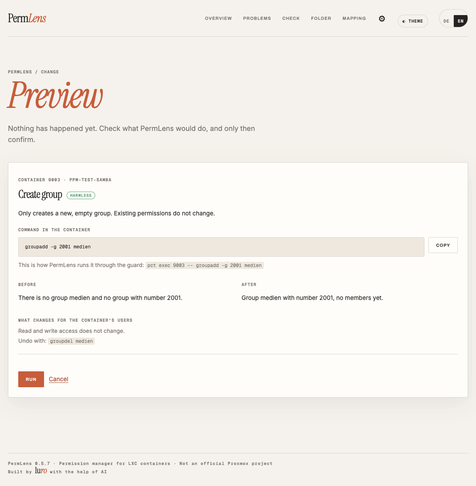
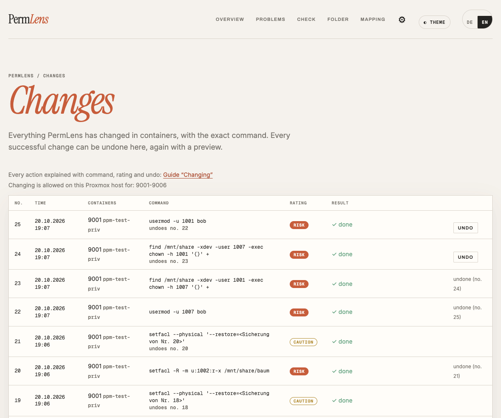
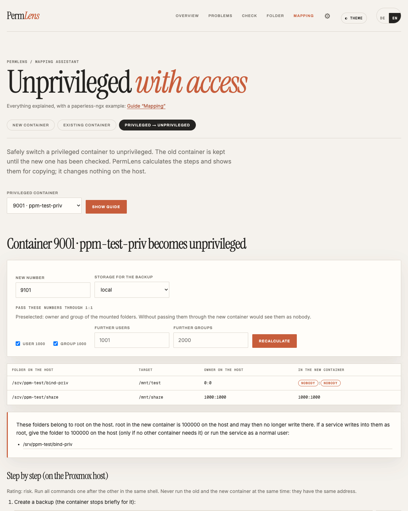

# Manual: PermLens in 15 minutes

*Deutsche Fassung: [ANLEITUNG.md](ANLEITUNG.md)*

PermLens is a permission manager for LXC containers, currently built specifically for Proxmox VE. It shows which users exist in your containers, who they are on the Proxmox host and who may access which mounted folders. If you want, it also applies the fix itself, always with a preview and undo.

This manual walks through everything once. The details are in separate guides:

| Topic | Guide |
|---|---|
| Installation, step by step | [INSTALLATION.en.md](INSTALLATION.en.md) |
| Update, backup, removal | [BETRIEB.md](BETRIEB.md) (German) |
| What PermLens may do on the Proxmox host | [SICHERHEIT.en.md](SICHERHEIT.en.md) |
| Check and problems, how PermLens calculates | [DIAGNOSE.en.md](DIAGNOSE.en.md) |
| Changing users, groups and permissions | [AENDERN.en.md](AENDERN.en.md) |
| Mapping, making a container unprivileged | [MAPPING.en.md](MAPPING.en.md) |

## 1. Setup

1. **Create an LXC for PermLens** (Debian 13, unprivileged, fixed IP address) and install Docker in it.
2. **Start PermLens**, most conveniently as a stack in Dockhand with [`docker-compose.homelab.yml`](../docker-compose.homelab.yml). Add the password as the variable `APP_PASSWORD`.
3. **Open it in the browser:** `https://<IP-of-the-LXC>:8443`. On the first visit the browser warns you because PermLens uses its own certificate. [INSTALLATION.en.md](INSTALLATION.en.md#4-open-it-in-the-browser) explains how to check that it is yours.
4. **Connect to Proxmox:** PermLens shows a single command. Copy it into the Proxmox shell (web interface → node → “>_ Shell”) and press Enter. Please read [SICHERHEIT.en.md](SICHERHEIT.en.md) first: it describes exactly what the command does.

PermLens then scans all containers and jumps to the overview by itself. All steps in detail: [INSTALLATION.en.md](INSTALLATION.en.md).

<picture><source media="(prefers-color-scheme: dark)" srcset="bilder/en/anmeldung-dunkel.png"></picture>

**Recommended:** right afterwards, add a code from an authenticator app under *Settings → Two-factor sign-in*.

## 2. The interface

<picture><source media="(prefers-color-scheme: dark)" srcset="bilder/en/uebersicht-dunkel.png"></picture>

The top bar has five menu items:

| Menu | Answers |
|---|---|
| **Overview** | How do things stand? The three most important problems, below that all containers and VMs. The **“Scan again”** button is here too. |
| **Problems** | Is everything all right? Everything PermLens found on its own, with a recommendation. |
| **Check** | Who can write here? |
| **Folder** | Who owns which folder, and how does each container see it? |
| **Mapping** | How does an unprivileged container get access to folders of the Proxmox host? |

Under the **gear** you find *Settings*, *Changes* (the log with undo) and *Sign out*. Next to it you switch between light and dark and between German and English.

**PermLens does not read continuously.** It shows the state of the last scan (the time is on every page). If you changed something on Proxmox, click “Scan again” on the overview. That usually takes 10 to 30 seconds.

**Several Proxmox hosts:** *Settings → Proxmox → Add another Proxmox …* adds one more. You then choose which one you are looking at below the top bar. Each has its own scanned state.

### The container page

Clicking a container in the overview opens its page with four tabs:

| Tab | Content |
|---|---|
| **At a glance** | Type (privileged or unprivileged), mapping, problems of this container, button to the mapping assistant |
| **Users and groups** | Every user as a card: what it is for, which number it has on the Proxmox host and what it may do in the mounted folders. Plus “Numbers without a name”, e.g. from Docker apps. |
| **Folder** | Mounted folders and shares (Samba, NFS), with “Check” and “Change permissions …” for each folder |
| **Host settings** | The lines from `/etc/pve/lxc/<id>.conf`, the important ones highlighted and explained. View only. |

Stopped containers only show their settings. Users and the view from inside are only available while the container is running.

<picture><source media="(prefers-color-scheme: dark)" srcset="bilder/en/container-host-dunkel.png"></picture>

## 3. The four tasks

### Is everything all right?

1. Open the **Overview**. The three most important problems are at the top, next to the number of all findings.
2. **Problems** shows them all. Every finding has a level: *Problem* (something does not work), *Note* (it works but is risky or fragile), *Info* (good to know).
3. Expand a finding: what is behind it, what can you do? Many have a command to copy, a “Run with PermLens …” button or a link to the right tool.

<picture><source media="(prefers-color-scheme: dark)" srcset="bilder/en/probleme-dunkel.png"></picture>

All findings and what they mean: [DIAGNOSE.en.md](DIAGNOSE.en.md#the-problems-page-findings).

### Can X write here?

1. Open **Check** (or click “Check” in the Folder tab of the container page).
2. Choose a container, a user and a folder, click “Check”.
3. The answer is at the top: **Read yes/no, Write yes/no** and the cause in one sentence, e.g. that the folder belongs to a number the container does not know (nobody).
4. Below it **“How to fix it”**: the recommendations with a command and a rating (harmless, caution, risk).
5. Collapsed: **“Make sure”** (ask the system itself or do a real write test) and **“How PermLens worked it out”** (every folder on the way).

<picture><source media="(prefers-color-scheme: dark)" srcset="bilder/en/pruefen-dunkel.png"></picture>

How PermLens calculates, and why the number counts rather than the name: [DIAGNOSE.en.md](DIAGNOSE.en.md).

### Change users and groups

Changing is **switched off** until you switch it on for specific containers on the Proxmox host. To do so, write the container numbers into a file in the Proxmox shell, e.g. for 105 and 110 to 112:

```bash
mkdir -p /etc/permlens && echo '105,110-112' > /etc/permlens/schreiben-erlaubt
```

Then in PermLens *Settings → Test connection*. All other containers stay read-only.

1. Container page → **Users and groups**.
2. At the top “New user …” or “New group …”. In each row “Change …”: add to a group, change the primary group, change the number, delete.
3. Every action first opens a **preview**: the exact command, the rating, before and after, what changes for the users, and the command to undo it. Nothing has happened yet.
4. **Run.** For *risk* you type the container number as a safety check.
5. *Gear → Changes* lists every change, with an **“Undo”** button (again with a preview).

<picture><source media="(prefers-color-scheme: dark)" srcset="bilder/en/container-benutzer-dunkel.png"></picture>

<picture><source media="(prefers-color-scheme: dark)" srcset="bilder/en/vorschau-dunkel.png"></picture>

<picture><source media="(prefers-color-scheme: dark)" srcset="bilder/en/aenderungen-dunkel.png"></picture>

You change folder permissions via *Check → How to fix it* or with “Change permissions …” in the Folder tab. PermLens never sets passwords; you type that command yourself in the container. Everything else: [AENDERN.en.md](AENDERN.en.md).

### Make a container unprivileged

A privileged container is convenient (root in the container is root on the host) but less isolated. You cannot switch with a checkbox, because all files in the container would then belong to the wrong numbers.

1. Container page → At a glance → **“Make unprivileged …”**. This opens the mapping assistant, tab *Privileged → unprivileged*.
2. PermLens works out which numbers occur in the mounted folders and need to be passed through, and writes down all commands: back up, restore as a **new** unprivileged container, add the mapping, give the files back, start, check.
3. You run the commands yourself in the Proxmox shell. The old container stays unchanged as a fallback. Delete it only after a few days.
4. Afterwards click “Scan again” in PermLens and use *Check* to see whether all important users can write again.

<picture><source media="(prefers-color-scheme: dark)" srcset="bilder/en/mapping-umstieg-dunkel.png"></picture>

For an unprivileged container that sees folders as nobody, the same assistant has the tab *Existing container* (on the container page: “Plan mapping …”), and for a new container the *blueprint*. All about it: [MAPPING.en.md](MAPPING.en.md).

## 4. Settings

| Section | What for |
|---|---|
| **Proxmox** | The connected Proxmox hosts, with guard version and the containers where changing is allowed. Add, rename, remove. |
| **Connection** | Test connection, set up again (e.g. for a new guard script), commands to switch changing on and off |
| **Two-factor sign-in** | A code from an authenticator app in addition to the password |
| **Updates** | A note when there is a new version. Nothing is installed automatically. |

## 5. What PermLens does not do

- **Nothing without a preview.** Every change shows the exact command first.
- **Nothing to system folders** such as `/etc` or `/usr`, nothing to root and system accounts, no passwords.
- **Nothing on the Proxmox host itself.** PermLens shows mapping, mount points and `/etc/subuid` as commands; you run them.
- **Nothing on a NAS.** PermLens cannot read the permission lists of a Synology, UGREEN or TrueNAS. It does tell you when the fix lies there.
- **No look inside VMs.** They only appear in the list.
